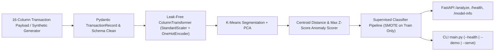

# Bank Transaction Anomaly Pipeline

[](https://github.com/subki72/Bank-Transaction-Anomaly-Pipeline/actions/workflows/ci.yml)
[](https://www.python.org/downloads/)
[](LICENSE)
[](pyproject.toml)

A production-grade hybrid machine learning pipeline and FastAPI inference service combining **unsupervised K-Means behavioral segmentation**, **centroid-distance & Z-score anomaly scoring**, and **leak-free supervised fraud classification** (`RandomForestClassifier`, `XGBClassifier`, `DecisionTreeClassifier`).

## Architecture Overview



## Key Engineering Improvements

- **Dual-Mode Architecture**: Preserves exploratory notebook workflows (`Clustering.ipynb`, `Classification.ipynb`) alongside a modular, testable `src/bank_anomaly/` package, unified `main.py` CLI, and FastAPI HTTP microservice.
- **Simultaneous IQR Outlier Filtering**: Replaces order-dependent sequential column filtering in `Clustering.ipynb` with `compute_simultaneous_iqr_mask` computed against the initial un-mutated DataFrame.
- **Zero Train/Test Leakage**: Replaces pre-split `pd.get_dummies` and full-dataset label noise with split-first `ColumnTransformer` (`OneHotEncoder(handle_unknown="ignore")`) and train-only `SMOTE` resampling.
- **100% Offline Determinism & Fallback**: Includes `generate_synthetic_transactions` matching all 16 raw dataset columns plus explicit `timeout=10` HTTP fetching with automatic synthetic fallback.
- **Artifact Deserialization Boundary**: Runtime services refuse legacy `.h5` pickle files and load/save strictly verified `.joblib` sklearn pipelines.
- **Operational Controls**: Structured leveled logging (`logging.getLogger(__name__)`), `/health` readiness probe, sliding-window rate limiting (`429`), bounded TTL prediction cache, restrictive CORS, and masked `500` error handler.

## Repository Structure

```text
.
├── src/bank_anomaly/
│   ├── __init__.py        # Public package exports
│   ├── config.py          # Environment-driven PipelineSettings & logging setup
│   ├── data.py            # 16-column schema, Pydantic TransactionRecord, synthetic data & IQR mask
│   ├── anomaly.py         # Leak-free ColumnTransformer, KMeans segmentation & anomaly scorer
│   ├── pipeline.py        # Supervised Random Forest / XGBoost / DT & HybridAnomalyPipeline
│   └── api.py             # FastAPI service (/health, /model-info, /analyze)
├── tests/                 # Offline unit & FastAPI integration suite (>= 75% coverage gate)
├── docs/
│   ├── adr/001-dual-mode-pipeline.md
│   └── runbook.md
├── main.py                # CLI entrypoint (--health | --demo | --serve)
├── Clustering.ipynb       # Patched unsupervised segmentation & anomaly notebook
├── Classification.ipynb   # Patched supervised fraud classification notebook
├── Dockerfile             # Multi-stage python:3.11-slim non-root container
├── docker-compose.yml     # Local container orchestration
└── Makefile               # Developer automation targets
```

## Quickstart

### 1. Clone and Install

```bash
git clone https://github.com/subki72/Bank-Transaction-Anomaly-Pipeline.git
cd Bank-Transaction-Anomaly-Pipeline
python -m venv .venv
source .venv/bin/activate  # On Windows: .venv\Scripts\activate
pip install -r requirements.txt
cp .env.example .env
```

### 2. CLI Execution (100% Offline)

```bash
# Verify configuration and baseline pipeline readiness
python main.py --health

# Run end-to-end synthetic segmentation + anomaly + classification demo
python main.py --demo --rows 400 --seed 42 --model random_forest

# Start FastAPI server
python main.py --serve --host 0.0.0.0 --port 8000
```

### 3. Developer Verification Gates

```bash
make lint
make test
```

### 4. Docker Deployment

```bash
docker compose up -d --build
curl http://127.0.0.1:8000/health
```

## API Endpoints

| Method | Path | Description |
|---|---|---|
| `GET` | `/health` | Liveness and model readiness status |
| `GET` | `/model-info` | Active model architecture, cluster count, and training summary |
| `POST` | `/analyze` | Batch segmentation, anomaly scoring, and optional fraud classification |

### Example `/analyze` Request

```bash
curl -X POST http://127.0.0.1:8000/analyze \
  -H "Content-Type: application/json" \
  -d '{
    "include_classification": true,
    "transactions": [
      {
        "TransactionID": "TX900001",
        "TransactionAmount": 1250.0,
        "TransactionType": "Debit",
        "Location": "Houston",
        "Channel": "Online",
        "CustomerAge": 29,
        "CustomerOccupation": "Student",
        "TransactionDuration": 18.0,
        "LoginAttempts": 5,
        "AccountBalance": 420.0
      }
    ]
  }'
```

## Documentation & Governance

- [Operational Runbook](docs/runbook.md)
- [ADR 001: Dual-Mode Pipeline](docs/adr/001-dual-mode-pipeline.md)
- [Security Policy](SECURITY.md)
- [Contributing Guide](CONTRIBUTING.md)
- [Changelog](CHANGELOG.md)

## License

Licensed under the [MIT License](LICENSE).
